# Architecture Diagram

Visual reference for how data flows through Alchemist Courier, from stored puzzle seeds all the way to pixels on screen and fingers on keyboard.

See `docs/architecture.md` for prose details on each system.

## System Overview

```mermaid
graph TB
    subgraph HUMAN["🧑 Human Being"]
        Eyes["Eyes see pretty pictures"]
        Fingers["Fingers move mouse & keyboard"]
    end

    subgraph GODOT["Godot Engine (rendering, input, scene tree)"]
        Viewport["Viewport<br/>pixels on screen"]
        InputEvents["InputEvent stream<br/>mouse pos, clicks, keys"]
    end

    subgraph GAME["Game Layer — src/Game/ (Godot-dependent)"]
        PuzzleScreen["PuzzleScreen<br/>orchestrates everything"]
        GridView["MetaGridView<br/>renders grid, ghost preview,<br/>hover detection"]
        Tray["ReagentTray<br/>sidebar item list"]
        StatusBar["StatusBarPanel<br/>cumulative aspect bars"]
        Objective["ObjectivePanel<br/>win condition display"]
        Primer["AspectPrimerPanel<br/>reaction rules reference"]
        Tutorial["TutorialScreen<br/>lesson flow"]
        TestHarness["TestHarness<br/>integration tests"]
    end

    subgraph CORE["Core Layer — src/Core/ (pure C#, NO Godot)"]
        subgraph GRID["Grid System"]
            MetaGrid["MetaGrid<br/>spatial model, cell ownership,<br/>placement constraint checks"]
            GridCell["GridCell<br/>position, bag owner,<br/>occupying reagent, state flags"]
        end
        subgraph BAGS["Bag System"]
            Bag["Bag / BagDefinition<br/>shape matrix, properties<br/>(Null, Gravity, Reinforced...)"]
        end
        subgraph REAGENTS["Reagent System"]
            Reagent["Reagent / ReagentDefinition<br/>shape, rotation, per-cell aspects,<br/>weight, value"]
            ShapeUtil["ShapeUtil<br/>rotation math, cell positions"]
        end
        subgraph CHEM["Chemistry System"]
            Engine["ChemistryEngine<br/>.Evaluate() → reactions<br/>.EvaluateProspective() → preview"]
            Rules["ReactionRuleDatabase<br/>7 MVP rules: explosion,<br/>neutralization, breakage..."]
            Aspects["Aspect / AspectSet<br/>hot, cold, volatile, stable,<br/>toxic, heavy, sharp..."]
        end
        subgraph PUZZLE["Puzzle System"]
            Generator["PuzzleGenerator<br/>seed → solvable puzzle<br/>(disassemble-a-solution)"]
            Solver["PuzzleSolver<br/>validate, reconstruct grid"]
            PuzzleState["PuzzleState<br/>serializable snapshot:<br/>bags, reagents, solution"]
            Daily["DailyPuzzleManager<br/>date-seeded daily puzzle,<br/>streak tracking"]
            TutorialData["TutorialData<br/>5 lessons, progressive<br/>mechanic introduction"]
        end
        subgraph SAVE["Save System"]
            SaveMgr["SaveManager<br/>JSON serialize/deserialize"]
            SaveData["SaveData<br/>tutorial progress, daily<br/>completions, streaks, codex"]
        end
        SeededRNG["SeededRandom<br/>deterministic PRNG"]
    end

    subgraph STORAGE["Persistent Storage"]
        FileSystem["File System (desktop)"]
        LocalStorage["localStorage (web)"]
    end

    subgraph TESTS["Test Layer"]
        XUnit["xUnit (289 tests)<br/>tests Core in isolation,<br/>no Godot needed"]
    end

    %% Human ↔ Godot
    Viewport --> Eyes
    Fingers --> InputEvents

    %% Godot ↔ Game
    InputEvents --> GridView
    InputEvents --> Tray
    InputEvents --> PuzzleScreen
    GridView --> Viewport
    Tray --> Viewport
    StatusBar --> Viewport
    Objective --> Viewport
    Primer --> Viewport

    %% Game orchestration
    PuzzleScreen --> GridView
    PuzzleScreen --> Tray
    PuzzleScreen --> StatusBar
    PuzzleScreen --> Objective
    PuzzleScreen --> Primer
    Tutorial --> PuzzleScreen

    %% Game → Core (the critical boundary)
    PuzzleScreen -- "initialize from" --> Solver
    PuzzleScreen -- "generate puzzle" --> Generator
    PuzzleScreen -- "confirm → evaluate" --> Engine
    GridView -- "can place? place/remove" --> MetaGrid
    GridView -- "hover preview" --> Engine
    StatusBar -- "read cumulative aspects" --> MetaGrid
    PuzzleScreen -- "save progress" --> SaveMgr
    PuzzleScreen -- "load progress" --> SaveMgr
    PuzzleScreen -- "get daily puzzle" --> Daily

    %% Core internal
    MetaGrid --> GridCell
    MetaGrid -- "bag ownership" --> Bag
    MetaGrid -- "reagent occupancy" --> Reagent
    MetaGrid -- "constraint checks:<br/>gravity, sharp, fragile, heavy" --> Bag
    Engine -- "read grid state" --> MetaGrid
    Engine -- "apply rules" --> Rules
    Engine -- "read aspects" --> Aspects
    Engine -- "modifier: Null suppression" --> Bag
    Reagent --> ShapeUtil
    Reagent --> Aspects
    Generator --> SeededRNG
    Generator --> MetaGrid
    Generator --> PuzzleState
    Solver --> PuzzleState
    Solver --> MetaGrid
    Daily --> Generator
    Daily --> SeededRNG
    TutorialData --> PuzzleState

    %% Save
    SaveMgr --> SaveData
    SaveMgr --> FileSystem
    SaveMgr --> LocalStorage

    %% Tests
    XUnit --> CORE

    %% Harness
    TestHarness --> PuzzleScreen

    %% Styling
    classDef human fill:#ffeaa7,stroke:#fdcb6e,color:#2d3436
    classDef godot fill:#74b9ff,stroke:#0984e3,color:#2d3436
    classDef game fill:#a29bfe,stroke:#6c5ce7,color:#2d3436
    classDef core fill:#55efc4,stroke:#00b894,color:#2d3436
    classDef storage fill:#fab1a0,stroke:#e17055,color:#2d3436
    classDef test fill:#dfe6e9,stroke:#b2bec3,color:#2d3436

    class Eyes,Fingers human
    class Viewport,InputEvents godot
    class PuzzleScreen,GridView,Tray,StatusBar,Objective,Primer,Tutorial,TestHarness game
    class MetaGrid,GridCell,Bag,Reagent,ShapeUtil,Engine,Rules,Aspects,Generator,Solver,PuzzleState,Daily,TutorialData,SaveMgr,SaveData,SeededRNG core
    class FileSystem,LocalStorage storage
    class XUnit test
```



## Data Flow: Placement (the core loop)

This is what happens every time the player moves their mouse or clicks:

```
  ┌──────────────────────────────────────────────────────────┐
  │  HUMAN: moves mouse over grid cell (5, 2)               │
  └──────────────────────┬───────────────────────────────────┘
                         ▼
  ┌──────────────────────────────────────────────────────────┐
  │  GODOT: fires InputEventMouseMotion                      │
  │  MetaGridView._Input() converts pixel → grid coords     │
  └──────────────────────┬───────────────────────────────────┘
                         ▼
  ┌──────────────────────────────────────────────────────────┐
  │  GAME: MetaGridView checks if a reagent is selected      │
  │  If yes → asks Core for placement preview                │
  └──────────────────────┬───────────────────────────────────┘
                         ▼
  ┌──────────────────────────────────────────────────────────┐
  │  CORE: MetaGrid.CanPlaceReagent(reagent, pos)            │
  │  ├─ bounds check                                         │
  │  ├─ all cells owned by a bag?                            │
  │  ├─ no overlaps?                                         │
  │  ├─ gravity valid? (if Gravity bag)                      │
  │  ├─ sharp constraint? (edge cells + Reinforced check)    │
  │  ├─ heavy constraint? (must be below lighter reagents)   │
  │  └─ fragile constraint? (no Gravity bags)                │
  └──────────────────────┬───────────────────────────────────┘
                         ▼
  ┌──────────────────────────────────────────────────────────┐
  │  CORE: ChemistryEngine.EvaluateProspective()             │
  │  ├─ temporarily place reagent                            │
  │  ├─ run all 7 reaction rules across 3 sensitivity tiers  │
  │  │   ├─ Adjacent: volatile net-hot, hot+cold neutralize  │
  │  │   ├─ SameBag: (future rules)                          │
  │  │   └─ WholeInventory: cumulative heat/cold/toxicity    │
  │  ├─ apply modifiers (Null suppress, Stable buff,         │
  │  │   Catalytic debuff, Medicinal buffer, Insulated)      │
  │  ├─ collect triggered reactions                          │
  │  └─ remove temporary placement (rollback)                │
  └──────────────────────┬───────────────────────────────────┘
                         ▼
  ┌──────────────────────────────────────────────────────────┐
  │  GAME: MetaGridView renders ghost preview                │
  │  ├─ reactions.Count == 0 → GREEN (safe)                  │
  │  ├─ only warnings       → YELLOW (caution)               │
  │  └─ danger reactions    → RED (bad idea)                 │
  │  StatusBarPanel updates projected cumulative totals       │
  └──────────────────────┬───────────────────────────────────┘
                         ▼
  ┌──────────────────────────────────────────────────────────┐
  │  GODOT: draws colored rectangles to viewport             │
  └──────────────────────┬───────────────────────────────────┘
                         ▼
  ┌──────────────────────────────────────────────────────────┐
  │  HUMAN: sees green/yellow/red ghost and makes a decision │
  │  clicks → MetaGrid.PlaceReagent() → loop repeats        │
  └──────────────────────────────────────────────────────────┘
```

## Data Flow: Puzzle Lifecycle

```
  ┌────────────────────────────────┐
  │  Seed (int)                    │
  │  e.g. 20260304 (daily)        │
  │  or random (free play)        │
  └──────────────┬─────────────────┘
                 ▼
  ┌────────────────────────────────┐
  │  PuzzleGenerator               │
  │  seed + DifficultyParams       │
  │  → SeededRandom                │
  │  → select bags & reagents      │
  │  → place valid solution        │
  │  → disassemble into puzzle     │
  └──────────────┬─────────────────┘
                 ▼
  ┌────────────────────────────────┐
  │  PuzzleState (serializable)    │
  │  bags[], reagents[], solution[]│
  └──────────┬─────────┬──────────┘
             │         │
     ┌───────┘         └────────┐
     ▼                          ▼
  ┌──────────────┐   ┌──────────────────┐
  │ PuzzleSolver │   │ SaveManager      │
  │ .Reconstruct │   │ .Serialize()     │
  │  Grid()      │   │ → JSON → disk    │
  │ → MetaGrid   │   │   or localStorage│
  │ + Reagent[]  │   └──────────────────┘
  └──────┬───────┘
         ▼
  ┌────────────────────────────────┐
  │  PuzzleScreen.Initialize()     │
  │  → MetaGridView (grid render)  │
  │  → ReagentTray (item list)     │
  │  → StatusBarPanel (aspect bars)│
  │  → ObjectivePanel (win cond)   │
  └──────────────┬─────────────────┘
                 ▼
  ┌────────────────────────────────┐
  │  Player solves puzzle          │
  │  (placement loop above)        │
  └──────────────┬─────────────────┘
                 ▼
  ┌────────────────────────────────┐
  │  Confirm button                │
  │  → ChemistryEngine.Evaluate() │
  │  → 0 reactions? → WIN          │
  │  → reactions? → FAIL (retry)   │
  │  → save progress + streak      │
  └────────────────────────────────┘
```

## Layer Boundary Rules

```
  ┌─────────────────────────────────────────────────────┐
  │  src/Core/     PURE C#                              │
  │                                                     │
  │  ✓ using System;                                    │
  │  ✓ using System.Collections.Generic;                │
  │  ✓ using AlchemistCourier.Core.Grid;  (custom V2I) │
  │  ✗ using Godot;              ← NEVER               │
  │  ✗ GD.Print()                ← NEVER               │
  │  ✗ Node, Control, Resource   ← NEVER               │
  │                                                     │
  │  Enforced by: custom Vector2I, namespace isolation, │
  │  289 xUnit tests that run without Godot             │
  ├─────────────────────────────────────────────────────┤
  │  src/Game/     GODOT-DEPENDENT                      │
  │                                                     │
  │  ✓ using Godot;                                     │
  │  ✓ using AlchemistCourier.Core.*;                   │
  │  ✓ extends Control, Node, etc.                      │
  │                                                     │
  │  Calls INTO Core, never the reverse.                │
  │  Converts Godot.Vector2I ↔ Core.Grid.Vector2I      │
  │  at the boundary.                                   │
  ├─────────────────────────────────────────────────────┤
  │  src/UI/       (empty — all UI is in Game/ for now) │
  └─────────────────────────────────────────────────────┘
```
